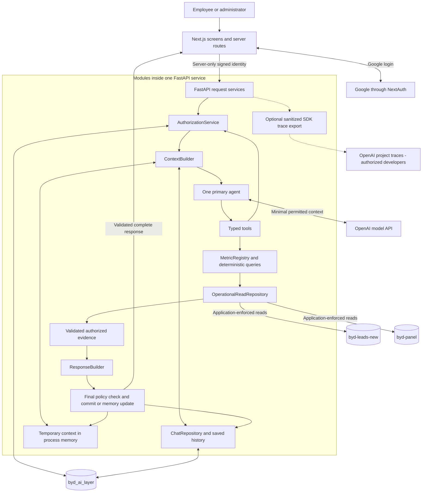

# Good Showroom AI Chatbot - Architecture

Purpose: Define the local system, trusted data boundaries, validated responses, and conversation lifecycle.

Status: Approved by User  
Updated: 2026-10-22  
Approval: The user approved the revised architecture on 2026-10-22 and authorized the Tech Stack draft only. No coding or ticket execution is authorized.
Basis: Approved [PRD](01-PRD.md), [Scope](02-SCOPE.md), [User Flows](03-USER-FLOWS.md), database findings in Scope section 5, and the user's explicit architecture revision request. Requested decisions are recorded in [DECISIONS.md](DECISIONS.md); implementation has not started. Remaining technical choices are listed in section 11.

## 1. System and Boundaries

Keep two local services: Next.js/TypeScript/Tailwind with NextAuth/Auth.js for Google login, and one modular Python/FastAPI backend using the OpenAI Agents SDK with one primary agent. The backend owns authorization, controlled database reads, metrics, responses, and application storage. Existing repositories supply schema/business context, not runtime APIs.



Edges show logical responsibilities, including storage-mode choices; they are not new services. Operational databases are queried for current facts. Application records are written only to `byd_ai_layer`. Temporary content exists only in process/browser working memory. Native OpenAI tracing is a separate, optional diagnostic path.

## 2. Module Responsibilities

| Module | Responsibility |
|---|---|
| Next.js UI/server routes | Login/status, chat/history, Temporary Chat, admin settings/review, safe cards/charts/tables; server session verification and protected forwarding. |
| Identity service | Bind verified Google provider ID to app user; validate internal identity tokens and login-session validity. |
| `AuthorizationService` | Central role/attribute policy for actions, tools, sites, records, fields, aggregates, history, and release checks. |
| `ContextBuilder` | Load authorized committed history and validated follow-up state; bound recent turns/summaries; separate instructions from retrieved data. |
| Primary agent/typed tools | Interpret questions, clarify, select approved tools, and explain verified evidence. No executable query/code generation. |
| `MetricRegistry` | Versioned business definitions and deterministic calculation rules. |
| `OperationalReadRepository` | Approved, bounded reads of named operational collections; no exposed mutations or raw driver escape hatch. |
| `ResponseBuilder` | Authoritative facts, grounded text, dataset/visual specification, coverage, and final schema validation. |
| `ChatRepository` / temporary state | Authoritative atomic saved-turn commits versus memory-only active-chat state. |
| Trace configuration/export boundary | Native SDK spans with explicit enablement, strict sanitization, safe IDs, and nonfatal export failures. |

Use injected model, clock, policy, repository, and tracing dependencies. Reuse async Mongo connection pools. Keep operational read interfaces distinct from app-write repositories; driver handles stay private to repository code. All project changes remain in `goodshowroom-ai-layer/`.

## 3. Operational Read Boundary

**ARCH-READ. Keep existing MongoDB credentials and permissions unchanged.** Both inspected operational connections report `readWriteAnyDatabase`. Read-only behavior is enforced by FastAPI code; it is not credential-enforced and cannot be guaranteed if application code is bypassed or credentials are compromised. Credential changes/rotation are not project prerequisites.

- Expose named read methods, approved collections, and typed filters only. No generic `execute`, database-command, raw collection/client, or unrestricted aggregation method is available to tools or application callers.
- Trusted query builders construct allowlisted operators/stages. Reject insert/update/delete/replacement/upsert, `$out`, `$merge`, server-side JavaScript such as `$where`/`$function`/`$accumulator`, and unapproved operators/commands. Recursively check nested pipelines; a denylist alone is insufficient.
- Validate current authorization before execution. Apply site/assignment/record restrictions before counting/grouping and field projections before return. Explicitly authorize every joined collection and joined record scope; forbid unapproved lookup/union targets.
- Enforce query deadlines, result limits, stable controlled pagination, bounded sorts, and projections. Exact limits follow in API design. Full counts use approved aggregation, not the size of a truncated page.
- Keep app writes bound to `byd_ai_layer`; never select the target database from model/browser input. Do not import reference backends' startup/index/import routines.

Tests must prove no public mutation/driver-escape capabilities and no operational write commands, using spies/mocks or isolated test databases. Do not attempt production writes to verify rejection. Existing source schemas/indexes stay unchanged.

## 4. Identity and Central Authorization

**ARCH-AUTH.** Next.js verifies the NextAuth server session, then sends a short-lived signed identity token to FastAPI over a server-only channel. Bind the verified Google provider account ID to an immutable application user ID; an email/display name or source staff role alone grants nothing. Verify email ownership before bootstrap/preapproval binding.

Validate issuer, audience, expiry, allowed signature algorithm, key ID/signature, and the originating login-session identifier/expiry. Keep signing keys in server-only configuration; document active/previous verification keys, rotation overlap, expiry, and emergency revocation in Security. Never expose internal tokens or signing keys to the browser/logs. Protect custom cookie-authenticated routes with CSRF/origin checks; NextAuth authentication-route protections are not a substitute. Keep FastAPI local and reachable through approved Next.js server routes.

Authorization combines **RBAC** (role-based capabilities) and **ABAC** (attributes such as site, ownership, assignment, selected records, field sensitivity, and chat owner/mode). Keep one active role with employee scopes that narrow its grants; deny wins. Central `AuthorizationService` checks approval/active role, tool availability, every data scope, field visibility, aggregate permission, saved-chat ownership/admin review, and final release. Missing/unverifiable policy denies access. No new policy framework is required.

Read an effective policy version covering account/role/grant changes at execution start. Recheck it on tool boundaries, before commit, and immediately before release. A change invalidates old evidence/context: stop, safely rebuild, or deny; never replay a cached result under stale permissions. Checks take effect at protected-action boundaries; already delivered information cannot be recalled.

Aggregate access is explicit. Restrict input records first, then apply a metric-specific disclosure policy for potentially identifying small groups. Sensitive breakdowns need an approved minimum-group/suppression rule, including complementary totals and repeated differencing risks. If no safe policy is defined, withhold that breakdown and offer a permitted broader result. No numeric threshold or new analytics capability is invented here.

One configured trusted Google email bootstraps the first admin once. Existing admins may add more admins. Make bootstrap/last-admin protections safe under concurrent changes. Admin chat review is separate from operational grants and developer tracing access.

## 5. MetricRegistry and Source Normalization

**ARCH-METRICS.** Every enabled metric defines: name/version and business meaning; approved collections; date fields and provenance/reliability; timezone; allowed filters/scopes; deterministic aggregation/deduplication rules; missing/incomplete-data handling; minimum coverage/disclosure policy; and authorization requirements. Store these as trusted backend definitions, not prompt-generated rules.

| Entry | Required meaning and release treatment |
|---|---|
| `total_leads` | Count eligible canonical lead records within the authorized scope and period under explicitly defined identity/exclusion rules. Use verified original/native creation dates. Report uncertain-date coverage; never silently replace with import/test-drive dates. Enable only the verified source/rule combinations. |
| `converted_leads` | Requires a defined conversion event/status, source relationships, date meaning, and deduplication rule. Remains disabled/outside the initial question set until its business definition and release scope are approved; no automatic inference from a status or matching sale. |

Use the approved dealership calendar-day boundaries, timezone-to-UTC conversion, and daylight-saving handling. Keep normalized dates, status mappings, source IDs, site and staff mappings in read adapters/app configuration without changing operational records. Scope contains the discovery evidence: 177/11,960 leads lacked `leadCreatedDate`; even populated dates can have uncertain provenance; live `dealer_studio` needs adapter support; two populated opportunity delivery references did not match. Unknown ownership never widens scope. Missing lead-date indexes require bounded queries and later query-plan checks, not immediate source changes.

## 6. Evidence-backed Responses and Injection Boundary

**ARCH-RESPONSE.** `ResponseBuilder` accepts only validated, authorized evidence carrying metric/source references, policy/metric version, scope/filters, absolute dates/timezone, coverage, and retrieval time. It constructs authoritative numbers and one structured dataset shared by text/cards/charts/tables. Pydantic validates status, text, facts, data, visual spec, provenance, warnings, freshness, and request ID.

Use deterministic templates for simple metric answers. Model explanations may reference only identifiable verified metric facts; validate claims against those facts, then reject/rebuild unsupported numbers. If free text cannot be reliably verified, use the deterministic answer rather than a permissive model self-check. Distinguish verified zero, incomplete coverage, denied/unsupported questions, and source failures. Render approved components, units, labels, pagination, and accessible alternatives; execute no model-generated HTML/JavaScript. Version 1 is non-streaming.

**ARCH-INJECTION.** Operational notes/comments/descriptions and user text are untrusted. Keep trusted instructions separate from retrieved data, minimize fields before model input, and fetch free text only when required by an approved tool. Retrieved text cannot change permissions, tool lists, database scope, or instructions. Never execute embedded commands. Privileged behavior exists only in validated server tools; prompts alone are not a security boundary. The same checks apply to summaries/history and model-selected arguments.

## 7. Authoritative Conversation Lifecycle

**ARCH-CHAT.** `ChatRepository` is the application-owned source of truth. The SDK's session feature automatically loads/saves items; therefore do **not** pass the permanent repository as an SDK `session`. Prepare bounded authorized input explicitly and call the agent without SDK automatic session persistence or provider-managed continuation (`conversation_id`, `previous_response_id`, or automatic chaining).

1. Verify identity, active login session, current policy, chat ownership/mode, request ID, and expected turn version. Serialize turns per chat.
2. Load committed authorized history, validated follow-up state, recent complete turns, and a budget-triggered older summary. New chats have no cross-session memory. Omit unsafe old content after permission changes.
3. Run the agent with ephemeral working items. Intermediate tool calls, rejected output, raw SDK run results, and failed model generations never enter authoritative chat history automatically.
4. Build/validate the final response and recheck policy/session validity. Construct a minimal completed-turn payload, including permitted evidence/state/summary updates; do not blindly save `to_input_list()` or `new_items`.
5. In saved mode, atomically commit the user/assistant pair, validated response/evidence/state, and required turn/version metadata through `ChatRepository.commit_completed_turn`. Use unique owner/session/request identity and expected-version checks. Final schema must provide an all-or-nothing commit through a bounded atomic envelope or an app-database transaction, not unrelated inserts.
6. Recheck release access and return the complete response. If permissions changed after a commit, restrict/redact that history on read and withhold stale output. Report failed persistence accurately.

Duplicate requests return the same completed result only after current authorization; incomplete/failed attempts never masquerade as committed turns. On disconnect/interruption before commit, cancel/discard working state and retain only safe status metadata. A commit completed before a lost response is recovered idempotently. Stale/concurrent retries cannot overwrite newer state. Summaries derive only from authorized committed turns and never replace current-data reads. Retention/deletion covers all saved derivatives; details follow in Schema/Security.

Administrators review saved messages through a separate audited read path. It cannot impersonate the owner, alter their chat, bypass current business-data grants, or populate the admin agent context automatically. Employees see the review notice. No trace records/links are exposed through this path.

## 8. Temporary Chat and Logout Cleanup

**ARCH-TEMP.** Temporary messages, summaries, evidence, visuals, context state, locks, and retry state remain in process memory only; browser working memory holds the current display/opaque ID. Never persist contents in MongoDB, browser persistent storage, ordinary logs, analytics, or trace payloads. Use one FastAPI process; restart loses temporary context. No Redis, distributed workers, or durable SDK session fallback.

Bind temporary context to app user **and the specific login session**, not just user ID. End-chat/logout calls a protected backend invalidation route, cancels in-flight work, clears memory, and clears browser state before completing logout where possible. Logout also invalidates the app login-session/generation so an old internal token cannot recover that context. Reject expired/revoked sessions on every request and final release; do not rely on the internal token's signature alone.

If cleanup delivery fails, block reuse through server-side session invalidation/revocation; periodic cleanup and session-expiry checks remove abandoned context. If both notifications fail, immediate remote deletion cannot be guaranteed: bound the residual lifetime by the login-session lease and idle expiry, disclose this limit, and never depend only on tab-close events. Ended contexts cannot be recreated by late tool/model responses. Explicit end, logout, auth expiry, and restart invalidate reuse. Keep the earlier proposed 30-minute idle expiry pending final lifecycle settings; define a bounded login-validity lease in Security/API design.

Temporary chats never appear in saved history or administrator review. Opt-in developer traces may retain **permitted diagnostic metadata only**, including for temporary turns. This is separate from a saved transcript and must be stated in privacy text.

## 9. Native OpenAI Tracing

**ARCH-TRACE.** Use the Agents SDK's native OpenAI trace exporter for authorized developer debugging. Configuration example (also in `.env.example`):

```env
APP_ENV=development
OPENAI_TRACING_ENABLED=true
OPENAI_TRACING_INCLUDE_SENSITIVE_DATA=false
```

These are application settings, not automatically recognized SDK variable names. Missing/invalid enablement means no export; unknown/missing environment is treated as non-development. Require explicit enablement in development. Outside development, force tracing off unless a separate documented approval is made; none exists currently. No inference should depend on trace-export success.

Map settings explicitly to `RunConfig.tracing_disabled` and `RunConfig.trace_include_sensitive_data`; configure global `set_tracing_disabled` and all explicit root `trace(...)`/custom spans consistently **before any traces are created**. The SDK defaults are not the application's privacy defaults. Real operational data and temporary turns require sensitive capture off; any future content-capture debugging requires separate approval and isolated synthetic fixtures.

Use static workflows `GoodShowroom.SavedChat` / `GoodShowroom.TemporaryChat`. Wrap authorization, context preparation, argument validation, tool execution, data validation, response construction, final policy checks, and persistence/memory outcomes with `custom_span` where supported. Native model/tool spans supply available timings/usage; sanitized custom fields cover missing metadata. An outer request trace includes pre/post-agent stages without creating another agent.

Allowlist request IDs, random diagnostic-session IDs distinct from auth credentials, static tool/metric/stage names, validation/outcome categories, durations, token counts, and available execution metadata. Never include email, passwords/tokens, URIs, raw arguments/results/chat, customer records, business metric values, or untrusted exception text in custom metadata. Generate/validate safe IDs; never derive them from personal information. Errors use fixed categories such as `authorization_denied`, `invalid_arguments`, `source_timeout`, `model_failure`, `response_invalid`, or `persistence_failed`.

Sensitive-input suppression does not sanitize arbitrary custom metadata/errors. Replace default trace processors at startup with `set_trace_processors(...)`: a native `BatchTraceProcessor` uses a sanitizing exporter wrapper, which copies/allowlists schema-compatible payloads **before** delegating to `BackendSpanExporter`. Do not merely add a redaction observer with `add_trace_processor`, which leaves an unfiltered default export path. Drop unsafe/unsanitizable batches; sanitize standard SDK errors too. No additional destination/platform is introduced. Export/flush failures drop diagnostics and produce only fixed safe log categories; they must not suppress real authorization/validation failures or break chat execution.

Inspection is limited by OpenAI project/dashboard access to authorized developers. App admins do not automatically have this access. Do not expose trace details, trace links, or inspection endpoints through employee chat, admin review, or public APIs. Maintain `store=false` for supported foreground model requests; it controls response storage, **not SDK traces**. Enabled export can create provider-side diagnostic records. Provider retention/access settings must be disclosed and reviewed; no zero-retention promise is made.

SDK behavior/API names checked on 2026-10-22 against current official guidance and official SDK source via Context7. Exact package pinning and exporter compatibility are implementation checks, not an SDK version selection in this document. References: [SDK tracing overview](https://developers.openai.com/api/docs/guides/agents/integrations-observability), [conversation strategies](https://developers.openai.com/api/docs/guides/agents/running-agents), [Python tracing controls example](https://developers.openai.com/cookbook/examples/agents_sdk/agent_improvement_loop), and [provider data controls](https://developers.openai.com/api/docs/guides/your-data).

## 10. Reproducible Verification

**ARCH-EVAL.** Maintain versioned synthetic fixtures and representative questions with frozen clock/timezone, explicit grants, expected tool/arguments, deterministic metric result, coverage/status, and visual dataset. Run injected/mock-model tests by default and isolated test-DB integrations. Optional live model evaluations record configured model/prompt/metric versions and safe results separately; they do not replace deterministic assertions or require an external evaluation platform.

Cover tool selection; lead calculations; calendar/DST boundaries; missing/partial data; unauthorized records/fields/joins/aggregates and small groups; stored-text prompt injection; follow-ups; matching numbers/text/charts; session isolation/admin review; mid-run revocation; interrupted/duplicate/concurrent turns; temporary non-persistence/logout/expiry; trace enablement/sanitization/nonfatal export; and repository mutation/escape prevention. Use secret/PII sentinel fixtures to verify their absence from exported payloads, logs, and temporary persistent storage. Ordinary tests never touch production data; no tests were implemented/run in this documentation step.

## 11. Deferred Technical Specifications and Review

Keep current credentials/source schemas and the two-service design. No deployment/CI/CD, Docker/Kubernetes, queues, Redis/Celery/Kafka, vector storage/embeddings, additional agents, or external monitoring services are introduced. Native tracing is the explicit exception to earlier blanket tracing/observability exclusions, not a monitoring platform.

| Existing document | Requirement for its later full draft |
|---|---|
| `06-DATABASE-SCHEMA.md` | Atomic turn layout/idempotency/version rules; policy/session records; retention; metric/evidence provenance. |
| `07-API-CONTRACTS.md` | Typed tool/response fields; commit/retry/status contracts; login/session invalidation; query/token/result limits and safe error categories. |
| `08-UI-UX-GUIDELINES.md` | Temporary/privacy notices, complete-answer states, coverage/suppression labels, approved visual components. |
| `09-SECURITY.md` | Key algorithms/rotation/token lease; CSRF/logout failure bounds; small-group thresholds/differencing rules; developer trace access/retention/export allowlist. |
| `10-TEST-STRATEGY.md` | Reproducible fixture/evaluation cases and proof for every ARCH requirement. |

Their placeholders receive handoff references only until each draft is authorized. Outstanding business semantics (date provenance, exclusions/deduplication, staff mapping, converted-lead meaning), saved retention, context budgets, temporary idle/lease settings, and small-group policy remain explicit. An undefined rule disables only the affected metric/disclosure, not project work. [Tickets.md](../Tickets.md) is the only implementation register; the user's request authorized recording these tasks in Backlog, not starting them. Architecture and Tech Stack are approved; see [Progress](../planning/PROGRESS.md) for the current document review. No coding or next phase starts automatically.
