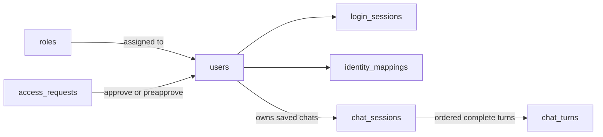

# Good Showroom AI Chatbot - Database Schema

Purpose: Map existing operational data and define the AI application's collections and persistence rules.

Status: Approved by User  
Updated: 2026-10-22  
Approval: The user approved this Database Schema on 2026-10-22 and authorized the API Contracts draft only. No coding or database changes are authorized.
Basis: Approved [Architecture](04-ARCHITECTURE.md)/[Tech Stack](05-TECH-STACK.md), all three reference repos, and the earlier read-only discovery in [Scope section 5](02-SCOPE.md). Collection/index designs below are approved but not created objects. Outstanding values and transaction capability remain unverified. No new live database inspection or changes occurred in this step.

## 1. Database Boundaries

| Database | Use | Access from AI layer |
|---|---|---|
| `byd-leads-new` | Leads, appointments, inventory, dealership/staff context | Approved reads through OperationalReadRepository |
| `byd-panel` | Customers, opportunities, sales, deliveries, staff context | Approved reads; delivery/conversion features remain outside the initial question set |
| `byd_ai_layer` | AI users, permissions, login state, settings, saved chats, audits | Necessary app reads/writes only |

Keep credentials, operational collections, schemas, and indexes unchanged. Read-only operational behavior is enforced by trusted application code, not the supplied MongoDB permissions. Do not copy business databases wholesale or reuse their users/passwords as chatbot accounts.

## 2. Operational Schema Reference

These are read mappings, not a full replacement schema. Live collection names take precedence over ODM model-name assumptions. Earlier samples were bounded; a field's presence/type does not prove its business meaning.

| Collection | Important existing fields and interpretation |
|---|---|
| Leads `leads` | BSON `_id`; string source IDs `leadId`, `virtualyardId`, `autogateLeadId`, `customerId`; `platform`, `status`, `stage`; `dealer`/`dealerName`; `assignedTo`/`allocatedPersonFullName`; date/null `leadCreatedDate`/`leadDate`, local `createdAt` (often import time). |
| Leads `appointments` | Source `leadId`/`appointmentId`; string `when`; date/null `testDriveDate`; dealership, platform, status. Do not assume its lead ID is a Mongo `_id`. |
| Leads `inventories`, `dealerships` | Stock/source identifiers and nested vehicle specifications; dealership name/timezone. Project safe fields; dealership documents can also contain integration credentials. |
| Both DBs `users`, `staff_site_memberships` | Mixed `_id`/string `id`, staff/site attributes, membership email/site arrays. These are mapping evidence, not chatbot approval. Never retrieve password/token fields for model context. |
| Panel `customers` | String `customer_id`; `site`, owner fields, nullable `lead_prospect_id`, `delivery_client_id`; BSON timestamps in samples. |
| Panel `opportunities` | String `opportunity_id` and `customer_id`; site, owner/stage, optional next-action and sales/delivery links. Required model fields can still be missing/null in live records. |
| Panel `clients`, `saleslogentries` | Delivery string `id`, site/agent/stage fields; sales `sales_log_id`, customer/opportunity links. Delivery dates/timestamps include strings, BSON dates, and nulls. |

Explicit panel joins: `opportunities.customer_id -> customers.customer_id`; `opportunities.sales_log_id -> saleslogentries.sales_log_id`; customer/opportunity `delivery_client_id -> clients.id`. Discovery matched all 354 opportunity customer links but only 349/351 populated opportunity delivery links. Cross-database lead/customer links require verified source-key semantics; do not guess from names, phones, or string shape.

There were 177/11,960 leads without `leadCreatedDate`; populated values can also be scrape/test-drive substitutions. Keep provenance/coverage explicit and normalize through read adapters. Current source code includes `dealer_studio`; its earlier omission claim in Scope is corrected. Other collections remain unavailable unless an approved tool needs them.

## 3. Common App Conventions

- Use opaque UUID strings for app `_id`/references (except named `app_settings` IDs), `snake_case`, `schema_version`, UTC BSON dates, and bounded documents/arrays. Mutable records have `created_at`/`updated_at`; completed turns/audits are immutable except approved deletion/redaction. Counts are integers.
- Source references are tagged objects: `{database, collection, key_field, key_type, key_value}`. Preserve string versus ObjectId identity; serialize ObjectIds canonically only with an explicit type tag. Only allowlisted server code decodes them into queries.
- Pydantic validates input/storage models; app collection validators/indexes reinforce shape and uniqueness when implemented. MongoDB references are not automatic foreign keys: services validate parents, owners, statuses, and scope. No arbitrary query/filter documents are stored as grants.

## 4. `byd_ai_layer` Collections

All IDs below refer to app UUIDs unless stated otherwise. `?` means optional/null. No temporary-chat documents exist.

| Collection | Core fields |
|---|---|
| `users` | `provider="google"`, `provider_account_id:string`, verified `email_key:string`, `display_name?`, `approval_status:pending/approved/rejected/revoked`, `role_id?`, typed `scope_limit`, `version:int`. Approved users require an active role and explicit scope. |
| `roles` | `name_key:string`, `active:bool`, `version:int`, typed capabilities/tool grants, permitted domains/sites/record modes/fields/aggregate metrics. Employee scopes can only narrow these grants. |
| `access_requests` | `kind:request/preapproval`, `email_key`, `user_id?`, `status:pending/approved/rejected/consumed/revoked`, `active:bool`, reviewed `role_id?`/`scope_limit?`, reviewer/time, `expires_at?`. Combining requests/preapprovals avoids placeholder user accounts. |
| `identity_mappings` | `user_id`, one `source_ref` identifying operational staff, verified assignment/site mappings, `mapping_version:int`, `active`, `verified_by`, `verified_at`. Ambiguous/name-only matches do not grant ownership. |
| `login_sessions` | `user_id`, `generation:int`, `expires_at`, `lease_valid_until`, `revoked_at?`, `version:int`. Stores validity metadata, never raw NextAuth cookies, Google tokens, or internal signed tokens. |
| `chat_sessions` | `owner_user_id`, safe generic title, `status:active/deleting`, `version:int`, `last_activity_at`, bounded `context_state`/authorized `summary?`, minimal `last_attempt?`, `expires_at?`. No ever-growing transcript array. |
| `chat_turns` | `session_id`, `owner_user_id`, `request_id`, `request_hash`, `sequence:int`, bounded `user_message`, validated `response`, permitted `evidence[]`, `question_state_after`, `policy_version`, `metric_versions`, `committed_at`, `expires_at?`. Every record is a complete committed turn. |
| `audit_events` | `actor_id`/`target_id` opaque IDs, fixed action/outcome/error category, request ID, `created_at`, `expires_at?`. Includes admin access/review and security events; never transcripts, secrets, raw exception text, or tool records. |
| `app_settings` | Named `_id` documents: access-control state (`policy_version:int`, `commit_fence:int`, `bootstrap_complete`); versioned site aliases/timezones and reviewed retention/disclosure settings. No secrets, prompts-as-policy, or model-generated metric definitions. |

Email normalization trims/lowercases for matching; do not invent Gmail dot/plus rewriting. Bind verified provider ID permanently; an email collision must not merge/rebind accounts automatically. Consume preapproval, close any pending request, and grant access atomically. Role/scope changes, mapping changes, revocation, and bootstrap/last-admin changes update the access-control version in the same transaction as their audit. Never hard-delete an assigned role without resolving its users.

`scope_limit`/role grants use fixed typed dataset, canonical site, record-mode (`assigned`, `selected`, `all_permitted`), selected source-reference, field, and metric selectors. Missing selectors deny access. Source aliases such as "All Sites" are not wildcard grants. Metric definitions stay in trusted backend code; saved evidence references their versions rather than enabling new metrics.

## 5. Evidence, Context, and Atomic Commits

Evidence includes a fact/metric ID, version, source references/date field/provenance, applied scope/filters, absolute period/timezone, retrieval time, coverage/warnings, and access tags for protected facts/fields. ResponseBuilder stores one validated text/data/visual representation tied to that evidence. Preserve only necessary permitted values, not raw database dumps or SDK run items. A summary records its covered turn sequence and policy/access tags; unknown authorization means omit/rebuild, not guess-redact.

**Approved atomicity choice: a transaction confined to `byd_ai_layer`.** Do model calls and operational reads before starting the transaction; keep it short.

1. Validate evidence/response and recheck owner, active login session, current policy, and expected saved-chat version.
2. In the transaction, conditionally increment `commit_fence` on the `app_settings` document `_id="access_control"` at the expected `policy_version`. Access/session revocation writes use this same control document, preventing stale-policy commits from racing them.
3. Recheck the active owner/login session and parent/expected version; insert one complete turn and advance session version/context/summary together. Session version starts at zero; the first turn has sequence one. Write required minimal audit metadata in the same transaction.
4. Commit all-or-nothing; then recheck access before release. Load history through a consistent snapshot/version-bound view. A committed answer is still filtered by current grants when reopened.

Unique request/sequence keys reject duplicates and stale writers. Same request with different content is a conflict. Recover an already committed retry only after current access checks; do not repeat model work after a confirmed commit. `last_attempt` holds only request/hash/status/timing/error-category metadata; failed/interrupted work has no authoritative message pair. Uncertain commit outcomes are looked up/retried idempotently, never reported as saved without confirmation.

Transaction support in the app connection must be verified during implementation; it was not tested by the operational discovery. Do not silently replace atomic commits with separate inserts. If unavailable, review a bounded single-document alternative; no credential/source-server change is authorized by this draft.

## 6. App Indexes

These indexes are for the AI database only and will be created during authorized implementation.

| Collection | Keys and purpose |
|---|---|
| `users` | Unique `(provider, provider_account_id)` and `email_key`; `(approval_status, updated_at)` for admin lists. |
| `roles` | Unique `name_key`. |
| `access_requests` | Partial unique `(kind, email_key)` where `active=true`; `(status, created_at)`. Consuming/rejecting closes the active entry. |
| `identity_mappings` | Unique source-reference tuple; `(user_id, active)`. One operational identity cannot silently map to multiple app users. |
| `login_sessions` | `(user_id, revoked_at)`; separate TTL on `expires_at`. |
| `chat_sessions` | `(owner_user_id, last_activity_at desc)`; `(last_activity_at desc)` for authorized admin review. |
| `chat_turns` | Unique `(session_id, request_id)` and `(session_id, sequence)`; sequence index supports ordered pagination. Owner must match the parent. |
| `audit_events` | `(actor_id, created_at desc)`, `(target_id, created_at desc)`; optional TTL after retention approval. |
| `app_settings` | Built-in unique `_id` for named settings/control documents. |

TTL means automatic expiry cleanup; it is delayed, so code always checks expiration/revocation before use. Do not rely on TTL for logout, access control, or parent-child deletion. Add content-expiry TTL only after the saved retention policy is approved; unique nullable fields need explicit partial/null behavior rather than accidental uniqueness assumptions.

## 7. Privacy, Deletion, and Open Values

Temporary messages, summaries, state, evidence, visuals, request hashes/locks, and temporary chat IDs remain memory-only. `login_sessions` may exist for authentication regardless of chat mode, but contain no temporary conversation content. Trace metadata follows Architecture section 9 and is not a Mongo transcript collection.

Deleting/expiring a saved chat first blocks new commits, then removes its turns, summary/state, and visual/evidence derivatives; MongoDB does not cascade references automatically. Retry bounded cleanup in the existing backend; no worker/queue is added. Retain only audit metadata allowed by its separate policy. Revocation denies the next protected action; it does not imply an unapproved history deletion policy. Never log emails or stored business facts into diagnostic metadata.

Review before implementation: saved/audit retention durations, document/result caps, transaction capability, exact staff/site aliases, trustworthy received-date/exclusion rules, and aggregate disclosure thresholds. `converted_leads` stays disabled until its meaning and scope are approved. These values do not require a new service or credentials to continue project work.

References: [lead model](../../byd-leads-backend/models/Lead.js), [lead dealership](../../byd-leads-backend/models/Dealership.js), [CRM customer](../../byd-sales-floor-backend/src/models/crm/Customer.js), [CRM opportunity](../../byd-sales-floor-backend/src/models/crm/Opportunity.js), [actual CRM collection access](../../byd-sales-floor-backend/src/services/crmService.js), [delivery models](../../shaun-backend/models.py), [delivery database/index setup](../../shaun-backend/db.py). MongoDB guidance: [transactions](https://www.mongodb.com/docs/manual/core/transactions/), [stale reads/write conflicts](https://www.mongodb.com/docs/v8.0/core/transactions-production-consideration/), [unique indexes](https://www.mongodb.com/docs/manual/core/index-unique/), [TTL behavior](https://www.mongodb.com/docs/manual/core/index-ttl/).

Schema approval is recorded. API Contracts is the current authorized draft; stop for its review before the next document. Do not create collections/indexes, change credentials/source schemas, or execute Backlog tickets without implementation authorization.

## TICKET-024 storage refinement — approved with recorded limits

Login storage adds `auth_started_at` and `auth_expires_at` from the verified
originating authentication session. The absolute cap is measured from that
original start, not from an exchange retry. Caller verification belongs to
TICKET-001; these private repository inputs are not browser claims.

The implemented TTL definition uses `purge_after`, calculated as at least
`expires_at + 150 seconds`, instead of the section 6 TTL on `expires_at`.
This is a visible implementation refinement for review: assertions can remain
valid for 120 seconds plus 30 seconds of tolerance near login expiry. Removing
the binding immediately at login expiry would lose replay evidence too early.
`expires_at` still denies access at its exact boundary. Revocation does not
shorten either timestamp. The UUID `_id` is the durable exchange replay key.
No live TTL/index migration has been performed. Do not install both TTL indexes;
review existing index state before any future explicitly authorized setup.

Approval: The user approved TICKET-024 and the replay-safe cleanup refinement on 2026-10-23. Real MongoDB index/TTL verification remains pending.
